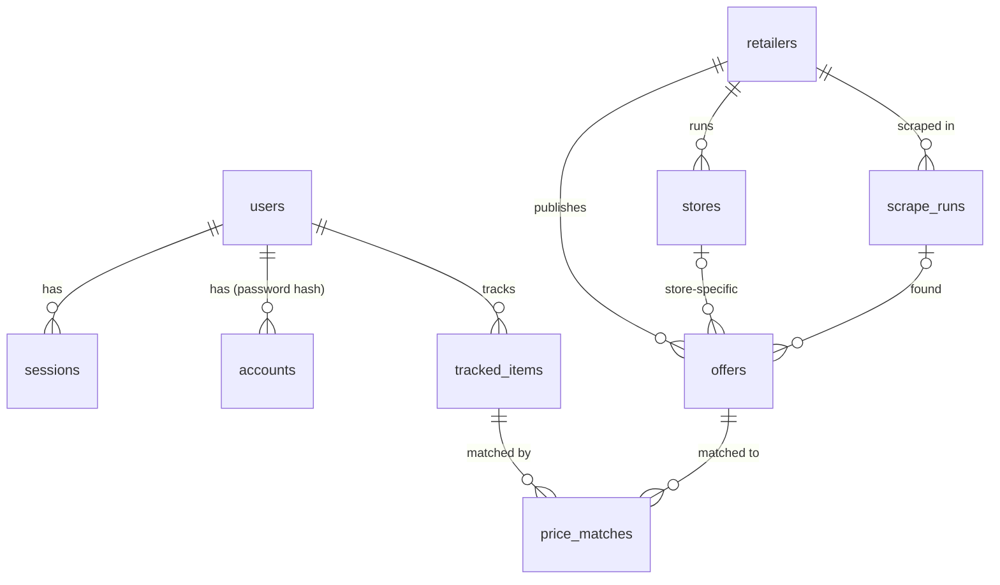

# Prisscanner

Tilbuds- og avisscanner: users track products such as "Rød Aalborg" and see the cheapest current
price and upcoming flyer price in their area, based on scraped retailer websites.

## Layout

```
apps/web          Next.js app: auth, dashboard, watchlist        (step 3)
apps/worker       scheduled scrape and match jobs                  (step 5)
packages/db       Drizzle schema, migrations, database client
packages/scanner  scrapers, offer normalisation, matching          (step 5)
```

## Requirements

- Node.js 22+ and pnpm 10
- PostgreSQL 16 (run `pnpm db:up` to start one with Docker)

## Getting started

```sh
cp .env.example .env
pnpm install
pnpm db:up        # start Postgres in Docker (skip if you run your own)
pnpm db:migrate   # apply migrations
pnpm db:seed      # insert the retailer list
```

## Commands

| Command            | What it does                                              |
| ------------------ | --------------------------------------------------------- |
| `pnpm test`        | Run all tests (needs `TEST_DATABASE_ADMIN_URL`)           |
| `pnpm typecheck`   | Type-check every package                                  |
| `pnpm check`       | Lint and format check (Biome)                             |
| `pnpm format`      | Apply lint fixes and formatting                           |
| `pnpm db:generate` | Generate a migration after changing `packages/db/src/schema` |

The database tests create a throwaway database for each run and drop it afterwards.

## Data model



- **users, sessions, accounts, verifications**: owned by Better Auth. Passwords are stored only as
  hashes in `accounts.password`. `users.postal_code` is the user's Danish postal code.
- **tracked_items**: what a user wants the cheapest price for. `normalized_term` (trimmed, lower
  case, single-spaced) is generated by Postgres and unique per user.
- **offers**: every scraped price, shared by all users. Prices are integer øre. `unit_price_ore`
  compares pack sizes (kr/l, kr/kg, kr/stk). The validity window is half-open: an offer is current
  when `valid_from <= now() < valid_to`; `valid_to` is null while a webshop price is still live.
  `search_vector` (Danish full text) and a trigram index on `title` support product matching.
- **price_matches**: links a tracked item to an offer, with the matcher's confidence score.
- **price_match_details** (view): a match joined with its offer, store and retailer.
  `is_current` and `is_future_flyer` are computed at query time, so they never go stale.
- **retailers, stores, postal_codes, scrape_runs**: the chains we scrape, their physical stores,
  postal code centre points for finding nearby stores, and a log of each scrape.
